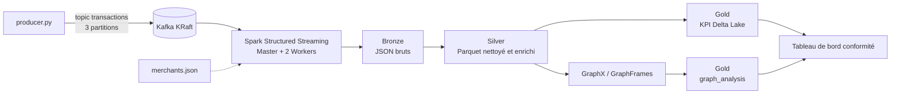

# sahlpay-data-platform

Distributed data platform for real-time mobile payment analytics and fraud detection using Apache Kafka, Spark, Delta Lake, GraphX and GraphFrames.

Projet du module **Écosystème Big Data 2** — 5ème année EMSI, année universitaire 2026–2027.

---

## 1. Contexte

**SahlPay.ma** (entreprise fictive) est un portefeuille mobile : paiements chez les commerçants par QR code (**P2M**) et transferts d'argent entre particuliers (**P2P**). L'application de paiement (API Spring Boot + PostgreSQL) produit un événement à chaque changement d'état d'une transaction : `INITIATED`, `AUTHORIZED`, `COMPLETED`, `REJECTED`, `REVERSED`.

Cette plateforme est une **preuve de concept reproductible** qui :

- collecte les événements dans **Apache Kafka** ;
- les traite de manière distribuée avec **Apache Spark** (SparkCore, Spark SQL, DataFrames, Structured Streaming) ;
- calcule des indicateurs de volume, de taux de rejet et des métriques sur fenêtres temporelles ;
- conserve les résultats en **Parquet / Delta Lake** dans **MinIO** (couches Bronze, Silver, Gold) ;
- analyse les relations comptes–appareils–bénéficiaires avec **GraphX** et **GraphFrames** afin de repérer des structures inhabituelles (appareils partagés, transferts circulaires, comptes collecteurs), sans conclure automatiquement à la fraude.

Elle complète le système de paiement sans remplacer PostgreSQL.

---

## 2. Architecture



### Organisation du bucket `lake` (MinIO)

```
lake/
├── bronze/
│   ├── history/               # transactions_history.jsonl (batch, Partie 2)
│   └── transactions_raw/      # JSON bruts lus dans Kafka (Partie 4)
├── silver/
│   ├── transactions_history/  # Parquet partitionné par city (Partie 3)
│   └── transactions_clean/    # Parquet partitionné par city et date (Partie 5)
├── gold/
│   ├── kpi_city_10min/        # Delta Lake, KPI fenêtre tumbling (Partie 5)
│   └── graph_analysis/        # Parquet partitionné par type d'anomalie (Partie 6)
└── checkpoints/               # checkpoints Structured Streaming
```

---

## 3. Stack technique

| Composant | Rôle | Version |
|---|---|---|
| Apache Spark (standalone) | Traitement distribué : 1 Master, 2 Workers (2 cœurs, 2 Go chacun) | 3.5.7 |
| Scala / Java | Langage et JVM du cluster Spark | Scala 2.12.18 · Java 17.0.16 |
| Python / PySpark | Driver et notebooks (conteneur Jupyter) | Python 3.10.12 · PySpark 3.5.7 |
| Apache Kafka (mode KRaft) | Bus de messages, topic `transactions` (3 partitions) | 3.9.1 |
| MinIO | Stockage objet compatible S3, bucket `lake` | RELEASE.2025-10-15 |
| JupyterLab | Développement des traitements | 4.4.10 |

### Dépendances Spark (US-03)

Déclarées dans [`infrastructure/spark/spark-defaults.conf`](infrastructure/spark/spark-defaults.conf), monté dans le conteneur Jupyter : chaque SparkSession les télécharge depuis Maven Central (cache dans le volume `ivy_cache`) puis les transmet aux Executors.

| Bibliothèque | Coordonnées Maven / paquet Python | Usage |
|---|---|---|
| Connecteur Kafka | `org.apache.spark:spark-sql-kafka-0-10_2.12:3.5.7` | Lecture du topic `transactions` (Parties 4 et 5) |
| Connecteur S3A | `org.apache.hadoop:hadoop-aws:3.3.4` | Lecture et écriture dans MinIO (`s3a://lake/...`) |
| Delta Lake | `io.delta:delta-spark_2.12:3.3.2` · `delta-spark==3.3.2` | Tables Gold, `DESCRIBE HISTORY` (Partie 5) |
| GraphFrames | `io.graphframes:graphframes-spark3_2.12:0.9.2` · `graphframes-py==0.9.2` | Motifs et degrés (Partie 6) |
| GraphX | inclus dans Spark 3.5.7 (Scala) | degrees, connectedComponents, PageRank (Partie 6) |

Règle de compatibilité : toutes les bibliothèques JVM sont compilées pour **Scala 2.12** et **Spark 3.5**. Le détail est documenté dans [`docs/epics/EPIC-01-infrastructure.md`](docs/epics/EPIC-01-infrastructure.md#15-user-story-us-03--configuration-et-validation-des-dépendances).

---

## 4. Structure du dépôt

```
sahlpay-data-platform/
├── docker-compose.yaml        # Kafka, Spark Master + 2 Workers, MinIO, Jupyter
├── .env.example               # Modèle de configuration locale
├── infrastructure/
│   ├── jupyter/Dockerfile     # Image Jupyter alignée sur le cluster Spark (+ Delta, GraphFrames)
│   └── spark/spark-defaults.conf  # Dépendances Spark, configuration S3A et Delta
├── producer/                  # producer.py, merchants.json
│   └── tests/                 # Tests automatisés du générateur
├── spark/
│   ├── batch/                 # Parties 2 et 3 : RDD, DataFrames, Spark SQL
│   └── streaming/             # Parties 4 et 5 : Structured Streaming, Delta Lake
├── graph/
│   ├── graphframes/           # Partie 6 : GraphFrames (PySpark)
│   └── graphx/                # Partie 6 : GraphX (Scala)
├── notebooks/                 # Notebooks Jupyter (montés dans le conteneur)
├── data/                      # Données locales (ignorées par Git)
├── docs/
│   ├── epics/                 # Documentation détaillée par epic
│   └── screenshots/           # Captures et preuves (EPIC-XX-US-XX_description.png)
├── services/                  # EPIC-07 : microservices et dashboard (bonus)
├── .gitattributes
├── .gitignore
└── README.md
```

---

## 5. Démarrage rapide

### Prérequis

- Git
- Docker Desktop (avec WSL 2 sous Windows)
- 16 Go de RAM recommandés

### Installation

```bash
git clone https://github.com/MRdrissi/sahlpay-data-platform.git
cd sahlpay-data-platform
git switch epic/01-infrastructure
cp .env.example .env          # puis remplacer le mot de passe MinIO
docker compose up -d --build
docker compose ps
```

### Initialisation (une seule fois par machine)

```bash
# Topic Kafka transactions (3 partitions)
docker compose exec kafka /opt/kafka/bin/kafka-topics.sh --bootstrap-server kafka:9092 \
  --create --topic transactions --partitions 3 --replication-factor 1

# Bucket MinIO lake
docker compose exec minio sh -c 'mc alias set local http://localhost:9000 $MINIO_ROOT_USER $MINIO_ROOT_PASSWORD'
docker compose exec minio mc mb local/lake
```

> Avant le lancement, vérifier avec `docker ps` qu'aucun autre conteneur n'occupe les ports 8080, 8081, 8082, 8888, 9000, 9001 ou 29092.

### Interfaces

| Service | URL |
|---|---|
| Spark Master UI | http://localhost:8080 |
| Spark Worker 1 / Worker 2 | http://localhost:8081 · http://localhost:8082 |
| Spark Application UI | http://localhost:4040 (pendant l'exécution d'un job) |
| MinIO Console | http://localhost:9001 |
| JupyterLab | http://localhost:8888 (jeton : `docker compose logs jupyter`) |
| Kafka (depuis l'hôte) | `localhost:29092` (`kafka:9092` depuis les conteneurs) |

### Arrêt

```bash
docker compose down           # conserve les volumes (données MinIO et Kafka)
docker compose down -v        # supprime aussi les volumes (topic, bucket, cache des dépendances)
```

Le guide complet de déploiement et de vérification se trouve dans [`docs/epics/EPIC-01-infrastructure.md`](docs/epics/EPIC-01-infrastructure.md#11-guide-de-déploiement-et-de-vérification).

---

## 6. Organisation du travail

### Branches

| Branche | Rôle |
|---|---|
| `main` | Versions livrées (jalons) |
| `develop` | Intégration des epics validés (prévue) |
| `epic/<numéro>-<nom>` | Développement d'un epic (ex. `epic/01-infrastructure`) |

### Workflow d'une user story

```bash
git pull --ff-only origin epic/01-infrastructure    # avant de commencer
# ... développement de la user story ...
git status && git diff
git add <fichiers-concernes>
git commit -m "feat(US-X): description"            # un seul commit par user story
git pull --rebase origin epic/01-infrastructure     # avant de pousser
git push origin epic/01-infrastructure
```

### Jalons

| Jalon | Contenu | Échéance |
|---|---|---|
| Jalon 1 | Parties 1, 2, 3 (batch) | 22/11/2026 |
| Jalon 2 | Parties 4, 5, 6 (streaming, GraphX, GraphFrames) + soutenance | 20/12/2026 |

---

## 7. Documentation par epic

| Epic | Contenu | Document |
|---|---|---|
| EPIC-01 | Infrastructure | [EPIC-01-infrastructure.md](docs/epics/EPIC-01-infrastructure.md) |
| EPIC-02 | Spark RDD | à venir |
| EPIC-03 | Spark SQL et DataFrames | à venir |
| EPIC-04 | Structured Streaming | à venir |
| EPIC-05 | Pipeline de production | à venir |
| EPIC-06 | Analyse de graphes | à venir |

---

## 8. Équipe

- Marwane
- Mouad
- Zakaria
