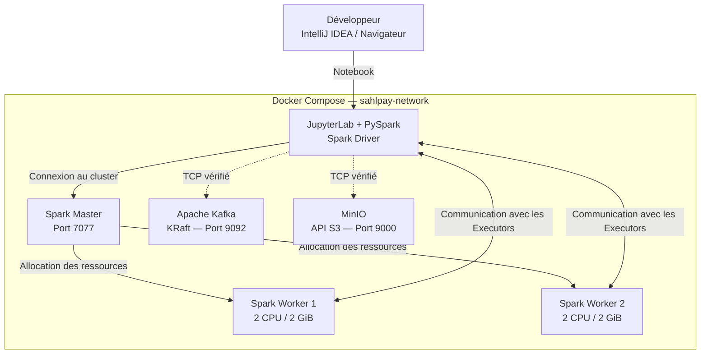
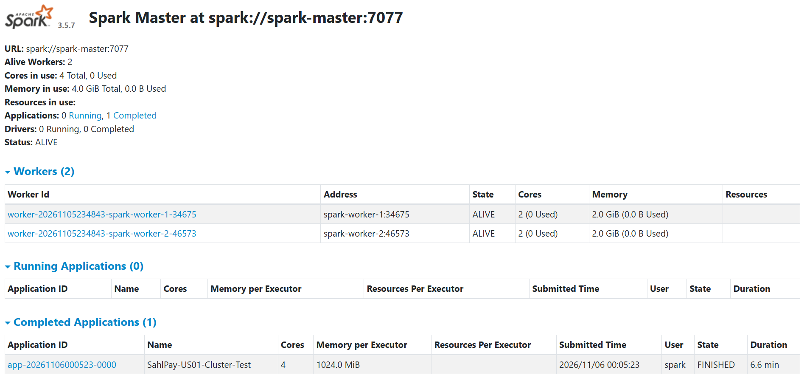
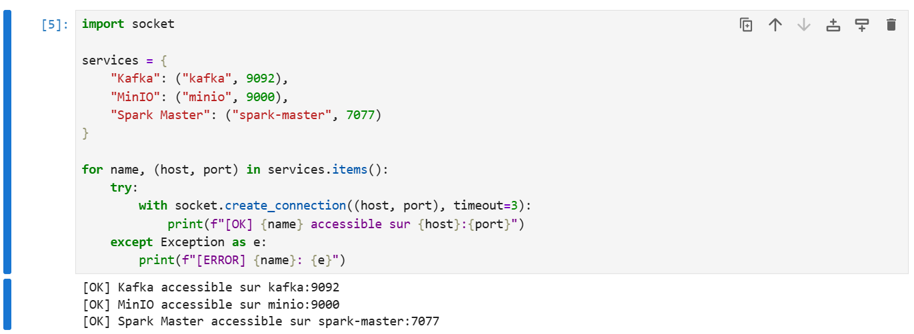

# EPIC-01 — Infrastructure Big Data

**Projet :** SahlPay Data Platform  
**Module :** Écosystème Big Data 2 — EMSI, 2026–2027  
**Repository :** [MRdrissi/sahlpay-data-platform](https://github.com/MRdrissi/sahlpay-data-platform)  
**Branche :** `epic/01-infrastructure`  
**Responsable US-01 :** Marwane Drissi  
**Statut US-01 :** ✅ Implémentée et validée techniquement

---

## 1. Objectif de l'Epic

L'EPIC-01 concerne la mise en place de l'environnement technique nécessaire au développement de la plateforme analytique SahlPay.

L'objectif est de disposer d'une infrastructure Big Data distribuée, reproductible et adaptée aux traitements batch et streaming.

Cette infrastructure doit notamment permettre :

- L'ingestion d'événements transactionnels avec Apache Kafka.
- L'exécution de traitements distribués avec Apache Spark.
- Le stockage persistant de données analytiques avec MinIO.
- Le développement interactif d'applications PySpark avec JupyterLab.
- La communication entre les différents services à travers un réseau Docker.

L'environnement est déployé localement à l'aide de **Docker Compose**.

### 1.1. User Story US-01

**Intitulé :** Mettre en place Docker Compose avec Kafka, Spark Master, deux Workers, MinIO et Jupyter.

**Objectif fonctionnel :**

Disposer d'un environnement distribué opérationnel permettant de développer, exécuter et tester les futurs traitements Big Data de SahlPay.

**Critères d'acceptation :**

- [x] Un fichier `docker-compose.yaml` fonctionnel est disponible.
- [x] Kafka démarre correctement en mode KRaft.
- [x] Spark Master et deux Spark Workers démarrent correctement.
- [x] MinIO est accessible.
- [x] JupyterLab est opérationnel.
- [x] Les conteneurs communiquent à travers le réseau Docker.
- [x] Spark Master affiche deux Workers actifs.
- [x] Aucun dysfonctionnement critique n'est observé sur les services lors des tests de validation.

**Validation complémentaire réalisée :** exécution réussie d'une application PySpark distribuée sur les deux Workers.

---

## 2. Choix d'architecture

### 2.1. Pourquoi Docker Compose ?

Le projet nécessite plusieurs services indépendants possédant chacun leurs propres dépendances et configurations.

Une installation directement sur Windows complexifierait la gestion des versions, des dépendances et des communications entre composants.

Docker Compose permet de définir l'ensemble de l'infrastructure dans un fichier déclaratif YAML.

Les principaux avantages sont :

| Avantage | Application dans SahlPay |
|---|---|
| Isolation | Chaque composant s'exécute dans son propre conteneur |
| Reproductibilité | L'environnement peut être reconstruit sur une autre machine |
| Gestion des dépendances | Les configurations sont centralisées |
| Réseau | Les services communiquent grâce au DNS Docker |
| Persistance | Les données Kafka et MinIO sont conservées dans des volumes |
| Maintenance | Les services peuvent être démarrés, arrêtés et inspectés individuellement |

L'infrastructure repose sur **six conteneurs Docker**.

### 2.2. Architecture déployée



**Remarque :** les connexions entre Jupyter, Kafka et MinIO ont été validées au niveau TCP. Le pipeline applicatif Kafka → Spark → MinIO n'est pas encore implémenté.

### 2.3. Technologies retenues

| Composant | Image / version | Responsabilité |
|---|---|---|
| Kafka | `apache/kafka:3.9.1` | Broker de messages en mode KRaft |
| Spark | `3.5.7` | Moteur de calcul distribué |
| Scala | `2.12` | Environnement Scala de Spark |
| Java | `17` | Runtime JVM |
| MinIO | `RELEASE.2025-10-15T17-29-55Z` | Stockage objet compatible S3 |
| JupyterLab | Image personnalisée | Développement et exécution PySpark |
| Docker Compose | v2 | Orchestration des conteneurs |

**Image Spark :**

```text
ghcr.io/apache/spark-docker/spark:3.5.7-scala2.12-java17-python3-ubuntu
```

Cette même image sert de base au Spark Master, aux Workers et à notre image Jupyter personnalisée.

Cela permet de conserver un environnement Spark cohérent entre les composants.

---

## 3. Organisation des ressources Docker

### 3.1. Services

Les services déclarés dans `docker-compose.yaml` sont :

```text
kafka
minio
spark-master
spark-worker-1
spark-worker-2
jupyter
```

Chaque service est exécuté dans un conteneur indépendant.

### 3.2. Réseau Docker

Tous les conteneurs utilisent un réseau commun :

```yaml
networks:
  sahlpay-network:
    driver: bridge
```

Nom du réseau Docker créé :

```text
sahlpay-data-platform_sahlpay-network
```

Le réseau permet aux conteneurs de communiquer directement en utilisant leurs noms de services.

Exemples :

```text
kafka:9092
minio:9000
spark-master:7077
```

Ces adresses sont résolues par le DNS interne de Docker.

**Distinction importante :**

- `localhost` depuis Windows désigne la machine hôte.
- `localhost` depuis un conteneur désigne ce conteneur.
- Le nom d'un service Compose permet aux autres conteneurs du réseau de le contacter.

### 3.3. Ports utilisés

| Service | Port hôte | Port interne | Fonction |
|---|---|---|---|
| Kafka | 29092 | 29092 | Accès Kafka depuis Windows |
| Kafka | Non publié | 9092 | Communication interne Kafka |
| Kafka Controller | Non publié | 9093 | Coordination KRaft |
| Spark Master | Non publié | 7077 | Communication Spark Standalone |
| Spark Master UI | 8080 | 8080 | Supervision du cluster |
| Spark Worker 1 UI | 8081 | 8081 | Interface du premier Worker |
| Spark Worker 2 UI | 8082 | 8081 | Interface du deuxième Worker |
| MinIO API | 9000 | 9000 | API S3 |
| MinIO Console | 9001 | 9001 | Administration web |
| JupyterLab | 8888 | 8888 | Interface notebook |
| Spark Application UI | 4040 | 4040 | Supervision des applications Spark |

Le Spark Master utilise :

```text
spark://spark-master:7077
```

Les ports des interfaces Spark et Jupyter sont publiés sur l'interface locale `127.0.0.1` de l'hôte.

Les ports Kafka et MinIO sont publiés selon les mappings définis dans le fichier Compose.

### 3.4. Volumes et persistance

Deux volumes Docker nommés sont utilisés :

```text
sahlpay-data-platform_kafka_data
sahlpay-data-platform_minio_data
```

**Volume Kafka :**

```yaml
volumes:
  - kafka_data:/var/lib/kafka/data
```

Il conserve les données du Broker et les informations nécessaires au stockage Kafka.

**Volume MinIO :**

```yaml
volumes:
  - minio_data:/data
```

Il conserve les objets enregistrés dans le stockage MinIO.

**Bind mount Jupyter :**

```yaml
volumes:
  - ./notebooks:/home/spark/notebooks
```

Ce montage permet de synchroniser directement les notebooks entre le conteneur Jupyter et le dossier local du repository.

Les modifications réalisées depuis Jupyter sont ainsi conservées sur l'ordinateur hôte.

---

## 4. Apache Kafka — Configuration KRaft

### 4.1. Rôle dans SahlPay

Kafka constitue la couche d'ingestion des événements.

Dans le futur pipeline, les événements transactionnels seront publiés dans un topic Kafka avant d'être consommés par Spark Structured Streaming.

Pour US-01, l'objectif est de déployer un Broker fonctionnel.

### 4.2. Pourquoi KRaft ?

Les anciennes architectures Kafka utilisaient ZooKeeper pour la gestion de certaines métadonnées du cluster.

Le mode **KRaft (Kafka Raft)** permet à Kafka de gérer ces métadonnées sans ZooKeeper.

Notre environnement utilise un nœud unique avec deux rôles :

- **Broker :** reçoit, stocke et sert les événements.
- **Controller :** assure la gestion des métadonnées du cluster.

Configuration :

```yaml
KAFKA_NODE_ID: 1

KAFKA_PROCESS_ROLES: broker,controller

KAFKA_CONTROLLER_QUORUM_VOTERS: "1@kafka:9093"

KAFKA_CONTROLLER_LISTENER_NAMES: CONTROLLER
```

Cette configuration est adaptée à un environnement de développement local.

Elle ne fournit pas de haute disponibilité.

### 4.3. Configuration des listeners

```yaml
KAFKA_LISTENERS: "PLAINTEXT://:9092,CONTROLLER://:9093,PLAINTEXT_HOST://:29092"

KAFKA_ADVERTISED_LISTENERS: "PLAINTEXT://kafka:9092,PLAINTEXT_HOST://localhost:29092"
```

Deux accès clients sont configurés.

**Depuis les conteneurs Docker :**

```text
kafka:9092
```

**Depuis Windows :**

```text
localhost:29092
```

Les `advertised.listeners` indiquent aux clients les adresses que le Broker leur communique pour établir les connexions Kafka.

Cette distinction est essentielle pour les futures intégrations avec PySpark et le producteur Python.

### 4.4. Configuration du stockage

Répertoire retenu :

```yaml
KAFKA_LOG_DIRS: "/var/lib/kafka/data"
```

Volume associé :

```yaml
volumes:
  - kafka_data:/var/lib/kafka/data
```

Ce choix permet d'utiliser un répertoire adapté aux permissions de l'utilisateur exécutant Kafka dans l'image officielle.

### 4.5. Vérifications effectuées

**Inspection des conteneurs :**

```powershell
docker compose ps
```

Le conteneur Kafka est apparu avec l'état :

```text
Up
```

**Inspection des logs :**

```powershell
docker compose logs --tail 50 kafka
```

Messages observés :

```text
The broker has been unfenced.
Transitioning from RECOVERY to RUNNING.
```

```text
Transition from STARTING to STARTED
```

```text
Kafka Server started
```

Ces messages confirment le démarrage du Broker.

**Vérification de l'accès au Broker :**

```powershell
docker compose exec kafka /opt/kafka/bin/kafka-topics.sh --bootstrap-server kafka:9092 --list
```

**Résultat :** commande exécutée sans erreur.

La liste était vide, car aucun topic applicatif n'avait encore été créé.

**Contrôle complémentaire disponible :**

```powershell
docker compose exec kafka /opt/kafka/bin/kafka-metadata-quorum.sh --bootstrap-server kafka:9092 describe --status
```

Cette commande permet d'inspecter le quorum KRaft et son contrôleur.

La création du topic `transactions` avec trois partitions sera effectuée dans une User Story ultérieure.

---

## 5. Apache Spark — Cluster Standalone

### 5.1. Objectif

Apache Spark est le moteur de traitement distribué de SahlPay.

Il permettra d'exécuter les traitements batch et streaming sur plusieurs ressources de calcul.

Notre infrastructure utilise le mode **Spark Standalone** :

- Un Spark Master.
- Deux Spark Workers.
- Des applications PySpark soumises depuis Jupyter.

### 5.2. Spark Master

Le Master est chargé de gérer les ressources du cluster.

Il permet notamment :

- L'enregistrement des Workers.
- La connaissance des ressources disponibles.
- L'allocation de ressources aux applications Spark.
- Le suivi des applications soumises.

Le Master est accessible à l'adresse :

```text
spark://spark-master:7077
```

Son interface web est publiée sur :

```text
http://localhost:8080
```

**Résultat des logs :**

```text
Successfully started service 'sparkMaster' on port 7077.
```

```text
Starting Spark master at spark://spark-master:7077
```

```text
I have been elected leader! New state: ALIVE
```

Le Master est donc opérationnel.

### 5.3. Spark Workers

Deux Workers ont été déployés avec les mêmes ressources.

| Paramètre | Worker 1 | Worker 2 |
|---|---|---|
| CPU | 2 cœurs | 2 cœurs |
| Mémoire | 2 GiB | 2 GiB |
| Version Spark | 3.5.7 | 3.5.7 |
| Interface hôte | 8081 | 8082 |
| Master | spark-master:7077 | spark-master:7077 |

Chaque Worker utilise la classe :

```text
org.apache.spark.deploy.worker.Worker
```

Leurs options de lancement définissent les ressources annoncées au Master :

```text
--cores 2
--memory 2G
```

### 5.4. Enregistrement auprès du Master

Les logs des deux Workers ont confirmé :

```text
Successfully registered with master spark://spark-master:7077
```

Ce message valide :

1. La résolution du nom `spark-master`.
2. La communication réseau sur le port 7077.
3. La disponibilité du Master.
4. L'enregistrement des deux Workers.

### 5.5. Validation depuis Spark UI

La console Spark Master a affiché :

| Indicateur | Valeur observée |
|---|---|
| Spark Version | 3.5.7 |
| Master Status | ALIVE |
| Alive Workers | 2 |
| Total Cores | 4 |
| Total Memory | 4 GiB |
| Master URL | spark://spark-master:7077 |

**Preuve :**



L'affichage des deux Workers avec l'état `ALIVE` constitue l'un des critères de validation principaux de US-01.

---

## 6. MinIO — Stockage objet

### 6.1. Objectif

MinIO est utilisé comme système de stockage objet compatible avec l'API Amazon S3.

Il accueillera les futures données analytiques de SahlPay.

L'architecture cible prévoit notamment :

```text
lake/
├── bronze/
├── silver/
├── gold/
└── checkpoints/
```

Le bucket `lake` et ses différents emplacements seront initialisés lors des étapes suivantes du projet.

### 6.2. Image utilisée

```text
ghcr.io/coollabsio/minio:RELEASE.2025-10-15T17-29-55Z
```

Il s'agit d'une image communautaire tierce.

Son utilisation dans cette preuve de concept est liée à l'indisponibilité de l'image initialement sélectionnée sur le registre Quay.

### 6.3. Configuration

Le serveur MinIO utilise :

```yaml
command: server /data --console-address ":9001"
```

Les ports :

```yaml
ports:
  - "9000:9000"
  - "9001:9001"
```

Le volume :

```yaml
volumes:
  - minio_data:/data
```

Et les variables d'environnement :

```yaml
environment:
  MINIO_ROOT_USER: ${MINIO_ROOT_USER}
  MINIO_ROOT_PASSWORD: ${MINIO_ROOT_PASSWORD}
```

Les identifiants sont définis localement dans `.env`.

Ce fichier est exclu du suivi Git.

### 6.4. Validation

Le conteneur MinIO a démarré correctement.

La console d'administration a été ouverte et testée depuis :

```text
http://localhost:9001
```

La connectivité TCP depuis Jupyter a également été validée.

L'écriture et la lecture d'objets avec Spark seront vérifiées lors des prochaines User Stories.

---

## 7. JupyterLab et PySpark

### 7.1. Rôle de Jupyter

JupyterLab fournit un environnement interactif permettant de développer et d'exécuter les applications PySpark.

Il permet notamment :

- La création de notebooks Python.
- L'exécution de cellules de code.
- La visualisation des résultats.
- L'exploration des DataFrames.
- La soumission d'applications au cluster Spark.

### 7.2. Image Docker personnalisée

Le Dockerfile est disponible dans :

[`infrastructure/jupyter/Dockerfile`](../../infrastructure/jupyter/Dockerfile)

Il repose sur la même image Apache Spark que les conteneurs Master et Workers.

```text
ghcr.io/apache/spark-docker/spark:3.5.7-scala2.12-java17-python3-ubuntu
```

Cette approche permet de conserver des versions cohérentes entre le Driver PySpark et le cluster Spark.

### 7.3. Positionnement du Driver

Dans notre architecture, le Driver Spark fonctionne dans le conteneur Jupyter.

Lorsqu'une SparkSession est créée :

1. Le Driver contacte le Spark Master.
2. Le Master alloue des ressources à l'application.
3. Des Executors sont lancés sur les Workers.
4. Le Driver organise les tâches et suit leur exécution.
5. Les Executors réalisent les calculs distribués.

Le Driver doit être accessible depuis les conteneurs Workers.

Pour cela, nous utilisons :

```python
.config("spark.driver.host", "jupyter")
.config("spark.driver.bindAddress", "0.0.0.0")
```

### 7.4. Interface JupyterLab

L'interface est accessible depuis :

```text
http://localhost:8888
```

Le token de connexion peut être récupéré avec :

```powershell
docker compose logs --tail 80 jupyter
```

Les notebooks sont conservés dans le dossier local :

```text
notebooks/
```

grâce au bind mount configuré dans Docker Compose.

---

## 8. Expérimentation — Premier calcul distribué

### 8.1. Objectif

Vérifier que Jupyter peut soumettre une application au Spark Master et utiliser les ressources des deux Workers.

Cette expérimentation va au-delà du simple démarrage des conteneurs.

### 8.2. Notebook utilisé

[`01_spark_cluster_test.ipynb`](../../notebooks/01_spark_cluster_test.ipynb)

### 8.3. Création de la SparkSession

```python
from pyspark.sql import SparkSession

spark = (
    SparkSession.builder
    .appName("SahlPay-US01-Cluster-Test")
    .master("spark://spark-master:7077")
    .config("spark.driver.host", "jupyter")
    .config("spark.driver.bindAddress", "0.0.0.0")
    .config("spark.executor.cores", "2")
    .config("spark.executor.memory", "1g")
    .config("spark.cores.max", "4")
    .getOrCreate()
)

sc = spark.sparkContext

print("Spark Version :", spark.version)
print("Spark Master :", sc.master)
print("Application :", sc.appName)
print("Parallelism :", sc.defaultParallelism)
```

Cette configuration permet :

- De connecter l'application au Master.
- De définir le nom de l'application.
- De rendre le Driver joignable depuis les Workers.
- De configurer les ressources des Executors.
- De limiter l'application à quatre cœurs.

### 8.4. Traitement exécuté

```python
df = spark.range(0, 1_000_000, numPartitions=8)

result = df.count()

print("Nombre de lignes :", result)
```

**Résultat obtenu :**

```text
Nombre de lignes : 1000000
```

Le traitement s'est terminé avec succès.

### 8.5. Interprétation

La méthode :

```python
spark.range(0, 1_000_000, numPartitions=8)
```

crée un DataFrame représentant un million de lignes réparties en huit partitions logiques.

L'appel :

```python
df.count()
```

déclenche une action Spark.

Le Driver organise l'exécution du calcul, tandis que les Executors exécutent les tâches nécessaires.

La répartition des tâches dépend des partitions, des ressources disponibles et de la planification Spark.

Le nombre de partitions ne correspond donc pas nécessairement au nombre d'Executors.

### 8.6. Observations dans Spark UI

Lors de l'exécution, Spark Master a affiché :

| Indicateur | Résultat |
|---|---|
| Applications actives | 1 |
| Nom | SahlPay-US01-Cluster-Test |
| Cœurs alloués | 4 |
| Worker 1 | 2 cœurs alloués |
| Worker 2 | 2 cœurs alloués |
| Mémoire allouée par Executor | 1 GiB |

Les quatre cœurs étaient alloués à l'application.

Cela ne signifie pas nécessairement qu'ils étaient tous occupés en permanence.

**Preuve :**


### 8.7. Fin de l'application

La SparkSession peut être arrêtée avec :

```python
spark.stop()
```

Cette opération termine l'application et libère les ressources allouées au cluster.

---

## 9. Validation des communications réseau

### 9.1. Objectif

Vérifier que le conteneur Jupyter peut accéder aux principaux services à travers le réseau Docker.

### 9.2. Test réalisé

```python
import socket

services = {
    "Kafka": ("kafka", 9092),
    "MinIO": ("minio", 9000),
    "Spark Master": ("spark-master", 7077)
}

for name, (host, port) in services.items():
    try:
        with socket.create_connection((host, port), timeout=3):
            print(f"[OK] {name} accessible sur {host}:{port}")
    except Exception as e:
        print(f"[ERROR] {name}: {e}")
```

### 9.3. Résultat

```text
[OK] Kafka accessible sur kafka:9092
[OK] MinIO accessible sur minio:9000
[OK] Spark Master accessible sur spark-master:7077
```

Les trois connexions ont réussi.

### 9.4. Interprétation

Ce résultat confirme :

- La résolution DNS des services.
- La connectivité TCP.
- L'accessibilité des ports internes depuis Jupyter.

**Limite :** ce test ne valide pas encore les échanges applicatifs Kafka–Spark ni les opérations S3 Spark–MinIO.

Ces tests seront réalisés lors des étapes d'intégration.

**Preuve :**



---

## 10. Difficultés rencontrées et solutions

La mise en place de l'infrastructure a nécessité la résolution de deux problèmes principaux.

### 10.1. Erreur 401 lors du téléchargement MinIO

**Image initialement utilisée :**

```text
quay.io/minio/minio:RELEASE.2025-09-06T17-38-46Z
```

**Erreur obtenue :**

```text
401 UNAUTHORIZED
```

Le registre distant refusait la récupération du manifeste de l'image.

**Solution retenue :**

```text
ghcr.io/coollabsio/minio:RELEASE.2025-10-15T17-29-55Z
```

Cette image a été téléchargée correctement.

MinIO a ensuite démarré et sa console a été testée avec succès.

### 10.2. Erreur de permissions Kafka

**Erreur initiale :**

```text
java.nio.file.AccessDeniedException:
/tmp/kraft-combined-logs/bootstrap.checkpoint.tmp
```

**Cause :**

Le processus Kafka, exécuté avec un utilisateur non privilégié, ne disposait pas des permissions nécessaires pour écrire dans le répertoire monté.

**Correction :**

Modification du répertoire de stockage Kafka.

Avant :

```yaml
KAFKA_LOG_DIRS: "/tmp/kraft-combined-logs"
```

Après :

```yaml
KAFKA_LOG_DIRS: "/var/lib/kafka/data"
```

Modification correspondante du volume :

```yaml
volumes:
  - kafka_data:/var/lib/kafka/data
```

Le volume Kafka initial a été supprimé durant la phase d'initialisation, alors qu'aucune donnée applicative n'avait encore été enregistrée.

**Commandes utilisées :**

```powershell
docker compose rm -sf kafka

docker volume rm sahlpay-data-platform_kafka_data

docker compose up -d kafka
```

**Résultat :**

Le nouveau conteneur Kafka a démarré correctement et le Broker est passé à l'état `RUNNING`.

**Enseignement :**

Les volumes Docker assurent la persistance des données, mais les permissions Linux déterminent si le processus exécuté dans le conteneur peut accéder à ces données.

---

## 11. Guide de déploiement et de vérification

### 11.1. Prérequis

- Docker Desktop.
- Docker Compose v2.
- Conteneurs Linux activés.
- Git.
- Une connexion Internet pour le premier téléchargement des images.
- Des ressources CPU et mémoire suffisantes.

L'environnement a été développé et testé sous Windows 11 avec IntelliJ IDEA et Docker Desktop.

### 11.2. Récupération du repository

```powershell
git clone -b epic/01-infrastructure https://github.com/MRdrissi/sahlpay-data-platform.git

cd sahlpay-data-platform
```

### 11.3. Configuration locale

Si le modèle `.env.example` est disponible :

```powershell
Copy-Item .env.example .env
```

Configurer ensuite les identifiants MinIO dans `.env`.

Variables requises :

```dotenv
MINIO_ROOT_USER=sahlpayadmin
MINIO_ROOT_PASSWORD=YOUR_LOCAL_PASSWORD
```

Le fichier `.env` ne doit pas être versionné.

### 11.4. Validation Docker Compose

```powershell
docker compose config --quiet
```

### 11.5. Démarrage

```powershell
docker compose up -d --build
```

### 11.6. Vérification des services

```powershell
docker compose ps
```

Les six conteneurs doivent apparaître avec l'état `Up`.

### 11.7. Consultation des logs

```powershell
docker compose logs --tail 50 kafka

docker compose logs --tail 50 spark-master

docker compose logs --tail 50 spark-worker-1

docker compose logs --tail 50 spark-worker-2

docker compose logs --tail 50 jupyter
```

### 11.8. Interfaces de supervision

| Interface | Adresse |
|---|---|
| Spark Master | http://localhost:8080 |
| Spark Worker 1 | http://localhost:8081 |
| Spark Worker 2 | http://localhost:8082 |
| MinIO Console | http://localhost:9001 |
| JupyterLab | http://localhost:8888 |
| Spark Application UI | http://localhost:4040 |

L'interface Spark Application UI est disponible lorsqu'une application Spark active l'expose.

### 11.9. Arrêt

```powershell
docker compose down
```

Cette commande arrête et supprime les conteneurs et le réseau Compose tout en conservant les volumes nommés.

**Attention :**

```powershell
docker compose down -v
```

Cette variante supprime également les volumes nommés.

Elle doit être réservée à une réinitialisation volontaire des données.

---

## 12. Limites techniques

L'infrastructure actuelle est une preuve de concept locale destinée à l'apprentissage.

Elle présente certaines limites :

**Infrastructure :**
- Tous les conteneurs fonctionnent sur une seule machine physique.
- Le cluster Spark ne dispose pas de haute disponibilité.
- Les ressources CPU et mémoire sont limitées.

**Kafka :**
- Un seul Broker.
- Un seul Controller KRaft.
- Pas de réplication multi-brokers.
- Communication PLAINTEXT.

**Stockage :**
- Volumes Docker locaux.
- Pas de stockage objet distribué sur plusieurs nœuds.
- Pas de mécanisme de sauvegarde externe configuré.

**Sécurité :**
- Configuration adaptée au développement local.
- Pas de mécanisme complet d'authentification et d'autorisation interservices.
- Les interfaces techniques ne doivent pas être exposées directement à Internet.

**Tests :**
- Les connexions TCP ont été validées.
- Un calcul PySpark distribué a été exécuté.
- Les traitements Kafka–Spark–MinIO de bout en bout restent à implémenter.

---

## 13. Bilan de l'US-01

L'objectif principal de US-01 était de déployer une infrastructure distribuée reposant sur Kafka, Spark, MinIO et Jupyter.

Les résultats obtenus sont les suivants :

| Critère | Résultat |
|---|---|
| Docker Compose | Fonctionnel |
| Kafka KRaft | Broker opérationnel |
| Spark Master | ALIVE |
| Spark Workers | 2 actifs |
| Ressources Spark | 4 cœurs et 4 GiB |
| MinIO | Console accessible |
| JupyterLab | Fonctionnel |
| Application PySpark | Exécutée avec succès |
| Calcul distribué | 1 000 000 lignes comptées |
| Connectivité réseau | Kafka, MinIO et Spark accessibles depuis Jupyter |
| Captures | Enregistrées |

### Conclusion

**US-01 est validée sur le plan technique.**

L'environnement constitue désormais une base fonctionnelle pour les prochaines étapes du projet SahlPay.

Il permettra notamment :

- La création du topic Kafka `transactions`.
- La configuration du bucket MinIO `lake`.
- La génération des historiques de transactions.
- L'exécution des premiers traitements batch avec Spark RDD.
- L'intégration progressive de Spark SQL et Structured Streaming.

La validation sur une seconde machine après clonage du repository constituera un contrôle complémentaire de reproductibilité.

---

**Documentation technique — EPIC-01 / US-01**  
**SahlPay Data Platform — Marwane Drissi**  
**Année universitaire 2026–2027**