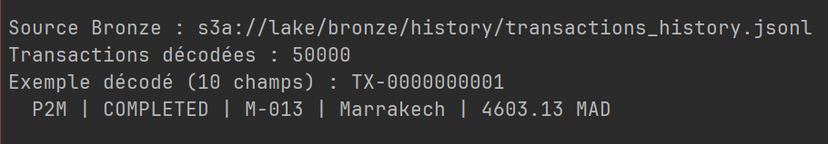
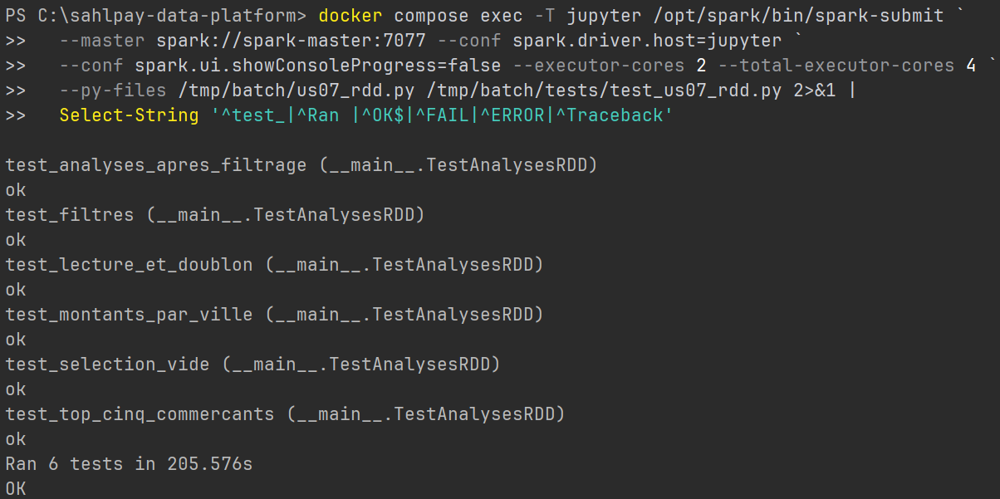

# US-07 — Analyses RDD des transactions Bronze

**EPIC-02 — Spark RDD · Jira SBD-14**

Le traitement batch répond à trois questions sur l’historique SahlPay. Combien d’événements correspondent à une sélection donnée ? Quels sont le total et la moyenne des montants dans chaque ville ? Quels sont les cinq commerçants qui ont reçu le plus de MAD en paiements terminés ? Le script affiche les réponses dans le terminal. [Script PySpark](../../../spark/batch/us07_rdd.py)

## 1. Source et prérequis

US-03 configure le connecteur S3A et valide l’accès du cluster Spark 3.5.7 à MinIO. US-06 utilise le producteur en mode fichier, valide le JSONL et le copie dans MinIO. US-07 reprend cet objet à chaque exécution. Sur un nouveau poste, suivre la procédure d’US-06 pour configurer `.env` et charger l’historique dans le MinIO local. [Configuration Spark et S3A](../EPIC-01-infrastructure.md) · [Génération et chargement de Bronze](us-06-bronze-history.md)

| Entrée | Valeur vérifiée |
|---|---|
| Objet lu par Spark | `s3a://lake/bronze/history/transactions_history.jsonl` |
| Format | Un événement JSON par ligne, dix champs par événement |
| Historique de référence d’US-06 | 50 000 événements, 49 000 identifiants de transaction distincts, 1 000 doublons intentionnels |
| Champs utilisés pour les analyses | `type`, `status`, `city`, `amount_mad` et `payee_id` |

SBD-79 a d’abord validé le lancement du script avec trois transactions totalisant 100 MAD. Depuis SBD-80, `textFile` lit Bronze et `map(decode_transaction)` transforme chaque ligne en dictionnaire Python. Le premier `count()` déclenche le décodage et le RDD est mis en cache pour les analyses suivantes. [Premier calcul sur le cluster](../../screenshots/EPIC-02-US-07_rdd_premier_calcul.png) · [Objet dans la console MinIO](../../screenshots/EPIC-02-US-07_minio_source_bronze.png)



## 2. Exécuter l’analyse depuis PowerShell

Les commandes s’exécutent depuis la racine du dépôt sur la branche `epic/02-spark-rdd`, avec Docker Desktop démarré. Le fichier `.env` fournit `MINIO_ROOT_USER` et `MINIO_ROOT_PASSWORD` au conteneur Jupyter. Préparer les services, puis copier le dossier batch dans le conteneur. Cette copie apporte le script et les tests. Spark lit les transactions directement dans MinIO.

```powershell
$OutputEncoding = [Console]::OutputEncoding = [System.Text.UTF8Encoding]::new($false)
docker compose up -d --build minio spark-master spark-worker-1 spark-worker-2 jupyter
docker compose cp .\spark\batch jupyter:/tmp
```

**Historique complet.** Ce lancement affiche un événement décodé, les montants de chaque ville et le classement global.

```powershell
docker compose exec -T jupyter /opt/spark/bin/spark-submit `
  --master spark://spark-master:7077 --conf spark.driver.host=jupyter `
  --executor-cores 2 --total-executor-cores 4 /tmp/batch/us07_rdd.py
```

**Sélection illustrée en SBD-81.** Les options se placent après le nom du script. Chacune peut être utilisée seule. Lorsqu’on en fournit plusieurs, un événement doit satisfaire tous les critères.

```powershell
docker compose exec -T jupyter /opt/spark/bin/spark-submit `
  --master spark://spark-master:7077 --conf spark.driver.host=jupyter `
  --executor-cores 2 --total-executor-cores 4 /tmp/batch/us07_rdd.py `
  --type P2M --status COMPLETED --city Marrakech
```

Le script accepte les types `P2M` et `P2P`. Il convertit le type et le statut en majuscules et compare la ville sans tenir compte de la casse. Pour cette commande, **1 919 événements** sont retenus parmi les 50 000. Le paiement `TX-0000000001`, reçu par `M-013` à Marrakech pour 4 603,13 MAD, en fait partie. [Capture du filtre combiné](../../screenshots/EPIC-02-US-07_rdd_filtres.png)

## 3. Règles de calcul et résultats sur Bronze

### SBD-82 — Montants totaux et moyens par ville

Pour chaque événement retenu, le script associe à sa ville le couple `(amount_mad, 1)`. `reduceByKey` additionne les montants et les effectifs. La moyenne est le **total de la ville divisé par son effectif**. Les calculs utilisent des montants décimaux et la moyenne est arrondie au centime avec `ROUND_HALF_UP`.

Sans option, tous les types, tous les statuts et les doublons de Bronze participent au calcul. Avec des filtres, le tableau porte sur la sélection. Une sélection vide affiche « Aucune ville pour cette sélection. »

| Ville | Événements | Total (MAD) | Moyenne (MAD) |
|---|---:|---:|---:|
| Agadir | 4 841 | 12 212 339,98 | 2 522,69 |
| Casablanca | 4 911 | 12 260 600,94 | 2 496,56 |
| Fes | 4 889 | 12 227 386,18 | 2 501,00 |
| Kenitra | 4 972 | 12 625 684,72 | 2 539,36 |
| Marrakech | 5 053 | 12 617 919,40 | 2 497,11 |
| Meknes | 4 971 | 12 534 326,64 | 2 521,49 |
| Oujda | 4 909 | 12 165 014,06 | 2 478,10 |
| Rabat | 5 617 | 12 299 897,48 | 2 189,76 |
| Tanger | 5 012 | 12 466 158,51 | 2 487,26 |
| Tetouan | 4 825 | 12 068 612,81 | 2 501,27 |

Avec les trois filtres de l’exemple, Marrakech totalise **4 755 142,96 MAD** pour **1 919 événements**, soit **2 477,93 MAD** en moyenne. [Capture des dix villes sans filtre](../../screenshots/EPIC-02-US-07_rdd_montants_par_ville.png)

### SBD-83 — Top 5 des commerçants

Le classement applique toujours `type == "P2M"` et `status == "COMPLETED"` à la sélection. Le commerçant est identifié par `payee_id`. Spark additionne les montants par commerçant avec `reduceByKey`, puis `takeOrdered(5)` retient les cinq plus grands totaux. À montant égal, l’identifiant croissant départage les commerçants. S’il y a moins de cinq commerçants admissibles, le classement contient autant de lignes que de commerçants admissibles. Si aucun paiement ne correspond, le script signale que la sélection est vide pour ce classement.

Sur l’historique complet, **18 560 paiements** et **300 commerçants** entrent dans ce classement.

| Rang | Commerçant | Total (MAD) |
|---:|---|---:|
| 1 | M-018 | 218 217,62 |
| 2 | M-099 | 212 676,91 |
| 3 | M-202 | 210 883,27 |
| 4 | M-130 | 205 252,84 |
| 5 | M-223 | 204 149,16 |

Avec `--city Marrakech`, `M-223` arrive en tête de la ville avec 204 149,16 MAD. [Capture du classement global](../../screenshots/EPIC-02-US-07_rdd_top5_commercants.png)

## 4. SBD-84 — Rejouer les tests de référence

Le jeu versionné contient **11 événements dont un doublon**. Les six tests exécutent les fonctions du script sur trois partitions et comparent les résultats à des valeurs fixées à l’avance. Ils couvrent le décodage, les filtres, les agrégations par ville, le classement, les analyses après filtrage et une sélection vide. [Jeu JSONL de référence](../../../spark/batch/tests/fixtures/us07_reference.jsonl) · [Suite de tests](../../../spark/batch/tests/test_us07_rdd.py)

Après la copie du dossier batch de la section 2, cette commande lance la suite sur le cluster.

```powershell
docker compose exec -T jupyter /opt/spark/bin/spark-submit `
  --master spark://spark-master:7077 --conf spark.driver.host=jupyter `
  --conf spark.ui.showConsoleProgress=false --executor-cores 2 --total-executor-cores 4 `
  --py-files /tmp/batch/us07_rdd.py /tmp/batch/tests/test_us07_rdd.py
```

Le bilan attendu est `Ran 6 tests` suivi de `OK`. Les deux exemples suivants permettent de contrôler les résultats à la main.

- À Casablanca, 70,00 et 50,01 MAD donnent 120,01 MAD au total et 60,01 MAD en moyenne après arrondi.
- Au cinquième rang, `M-005` et `M-006` totalisent 40,00 MAD chacun. La règle de départage retient `M-005`.



## 5. Reprise par les US suivantes

- **US-08** peut relancer l’analyse et consulter l’interface de l’application sur `http://localhost:4040` pendant l’exécution. Les transformations `map` et `filter`, les regroupements `reduceByKey` et les actions `count`, `collect` et `takeOrdered` donnent des opérations concrètes à retrouver dans les jobs et les stages.
- **US-13** peut comparer les résultats RDD à ceux des DataFrames et de Spark SQL en utilisant le même historique, les mêmes filtres, le même traitement des doublons et le même arrondi. Les deux résultats de Marrakech, sur la ville entière puis sur les seuls paiements P2M terminés, permettent de vérifier le périmètre avant de comparer les performances.
